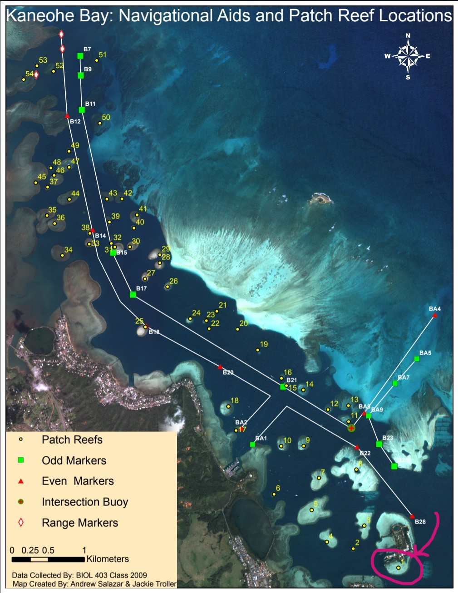
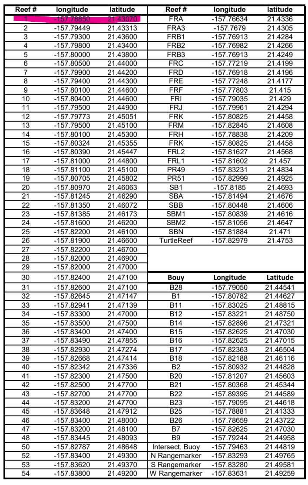
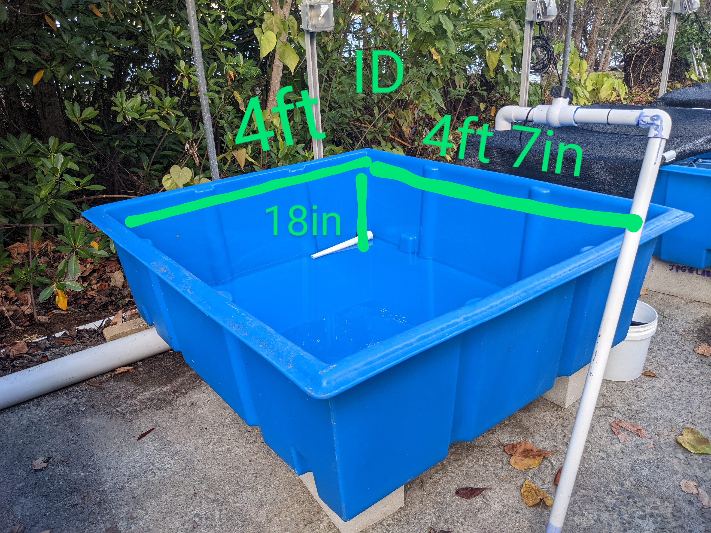

# Background

Describe the *Montipora capitata* coral colony collections under State of Hawai\`i Special Activities Permit 2024-35 and tank acclimation prior to spawn night research activities in June & July 2024 at HIMB.

## Install & load packages

```{r}
#| message: false
#| warning: false
## Load packages
library(ggplotify)
library(tidyverse)
library(leaflet)
```

# Coral collection location






# Leaflet interactive map

```{r}
coral_collection <- data.frame(
  site = 'HIMB',
  reef = 1,
  lat = 21.431619,
  lon = -157.787127,
  collection_date = as.Date('06/30/2024', format = '%m/%d/%Y'),
  colony_count = 20,
  colony_size_cm = 30,
  permit = 'SAP2024-35') 


# Prepare the text for the tooltip:
mytext <- paste(
   "Patch Reef: ", coral_collection$reef, "<br/>", 
   "Collection Date: ", coral_collection$collection_date) %>%
  lapply(htmltools::HTML)

# Generate Map
KB <- leaflet(coral_collection) %>% 
  addTiles()  %>% 
  setView( lng = -157.787347, lat = 21.431229, zoom = 18 ) %>% 
  addProviderTiles("Esri.WorldImagery") %>% 
  addCircleMarkers(~lon, ~lat, 
    fillColor = "orange", fillOpacity = 0.7, color="white", radius=8, stroke=FALSE,
    label = mytext,
    labelOptions = labelOptions( style = list("font-weight" = "normal", padding = "3px 8px"), textsize = "13px", direction = "auto")
  )%>%
  # Add a visible range (e.g., 100 meters)
  addCircles(~lon, ~lat,
    radius = 60,  # in meters
    color = "blue", fill = FALSE, weight = 2
  )

# Display map
KB
```
# Tank acclimation



In inches the tank dimensions are 48in W x 55in L x 18in D. The water height was variable, and determined by the level of the stand-pipe. During acclimation 30cm diameter corals were kept in water \~15in deep. Total volume of water that corals were acclimated in was therefore:

```{r}
incube <- 48*15*55
print(paste(incube,'inches cubed'))
```

1in^3^ (1 cubic inch) is equal to 0.0043290043 US gallons.

The volume of water in gallons is therefore:

```{r}
gal <- incube*0.0043290043
print(paste(gal, 'gallons'))
```

Finally, 1US gallon = 3.78541 liters

```{r}
L <- gal*3.78541
print(paste(L, 'liters'))
```

We used [12qt(11.4L) cambro chambers](https://www.cambro.com/Products/food-storage/square-food-storage-containers/camsquares-classic-food-storage-containers/camsquares-camwear/12SFSCW135) as the individual bins for spawning.
